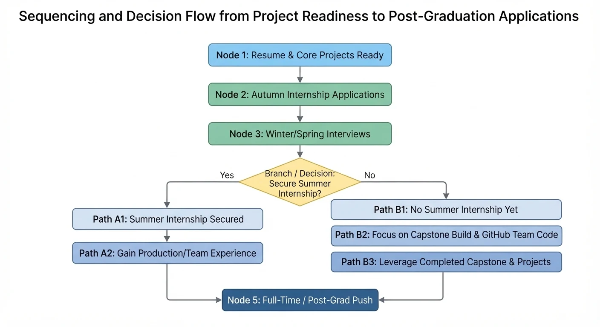

# Best Practices for Preparing for a Full Stack Developer Career Before Graduation

*© Markus Spiske via Pexels*

## Table of Contents
- [Purpose](#purpose)
- [Building Software Architecture and Infrastructure Habits](#building-software-architecture-and-infrastructure-habits)
  - [Designing Modular System Architectures Before Coding](#designing-modular-system-architectures-before-coding)
  - [Mastering Backend Data with Cloud Workflows](#pairing-backend-data-with-cloud-workflows)
- [Gaining Practical Experience Outside the Classroom](#gaining-practical-experience-outside-the-classroom)
  - [Building Meaningful Collaborative Code on GitHub](#building-meaningful-collaborative-code-on-github)
  - [Aligning Internships and Capstone Milestones](#aligning-internships-and-capstone-milestones)
- [Strengthening Communication and Interview Readiness](#strengthening-communication-and-interview-readiness)
- [References](#references)

## Purpose
Securing an entry-level Full Stack Developer role takes more than finishing standard classes; you need hands-on habits that match how engineering teams ship software. Following a focused graduation plan helps you build practical system design, deployment, and teamwork skills before applying for full-time positions. Using these practices early gives you concrete projects and clear examples to stand out during competitive hiring cycles.

## Building Software Architecture and Infrastructure Habits

### Designing Modular System Architectures Before Coding

Writing local code without structured design habits leaves you vulnerable to technical debt and messy repositories. Production engineering teams draft design documents and diagrams before writing code so teammates can catch flaws early and align on system trade-offs [4].

Break features into clean, reusable modules, sketch system models before coding, and document architectural trade-offs in your team repositories. Applying these habits across your coursework and personal projects prepares you to work inside larger codebases where clarity and maintainability matter just as much as getting code to run.

### Mastering Backend Data and Cloud Workflows

A frontend interface alone cannot support a production app without dependable data storage, audit trails, and repeatable deployment pipelines [2], [4]. Full stack development requires connecting client code to well-structured databases and predictable server environments.

Build end-to-end projects around upper-division electives like CSS 475 Database Systems and CSS 436 Cloud Computing by designing clean schemas, adding data history logs, and deploying services to the cloud [4]. Pair those classes with hands-on practice in Docker containers and automated unit tests so releases stay reliable.

## Gaining Practical Experience Outside the Classroom

### Building Meaningful Collaborative Code on GitHub

Solo class assignments rarely show how teams handle pull requests, merge conflicts, and code reviews. Contributing to shared repositories and real-world builds gives hiring managers concrete proof of how you solve problems with others [3], [4].

Join UWB ACM hackathons, contribute to active open-source projects, or build software that solves a real operational problem you can explain end to end [4]. Focus on small, well-tested pull requests, clear commit messages, and thoughtful review comments so your commit history reflects real engineering value rather than empty activity just to fill a chart.

### Aligning Internships and Capstone Milestones

Missing recruiting deadlines is an easy way to lose out on strong software internships and early-career roles [1]. Because many companies open summer internship applications in Autumn and convert strong interns into full-time hires, planning your quarters around hiring calendars keeps your portfolio ready when openings post [4].

Map your application prep ahead of peak recruiting windows, and treat your capstone as a flagship project you can walk through in detail. Instead of cramming everything into one timeline, focus on the timing trade-off shown in Figure 1 between capstone scope and recruiting cycles.

*Figure 1: Sequencing and Decision Flow from Project Readiness to Post-Graduation Applications.*

## Developing Professional Communication and Interview Readiness

Strong coding skills will not carry you through interviews if you cannot explain pull requests, design documents, or debugging decisions in plain language [4]. Recruiters and engineers evaluate clear writing, ownership, and team fit alongside technical ability.

Prepare concise STAR (Situation, Task, Action, Result) stories from group projects, part-time work, and independent builds, and practice summarizing technical trade-offs for non-technical teammates [4]. Conduct informational interviews with working software engineers and give clear feedback during peer evaluations to sharpen how you communicate under pressure.

---

## References

[1] U.S. Bureau of Labor Statistics, "Occupational Outlook Handbook: Software Developers," *U.S. Bureau of Labor Statistics*, 6 September 2023. [Online]. Available: https://www.bls.gov/ooh/computer-and-information-technology/software-developers.htm. [Accessed Oct. 22, 2026].

[2] D. Cassel, "What Do Full-Stack Developers Actually Do Today?", *The New Stack*, 14 February 2024. [Online]. Available: https://thenewstack.io/what-do-full-stack-developers-today/. [Accessed Oct. 22, 2026].

[3] GitHub Docs, "Contributing to a project," *GitHub Docs*, 2026. [Online]. Available: https://docs.github.com/en/get-started/exploring-projects-on-github/contributing-to-a-project. [Accessed Oct. 22, 2026].

[4] Kaan [Last Name Withheld], Software Engineer at Costco Wholesale IT, Issaquah, WA. Personal communication (Informational Interview), November 2026.

[word count: 653]
