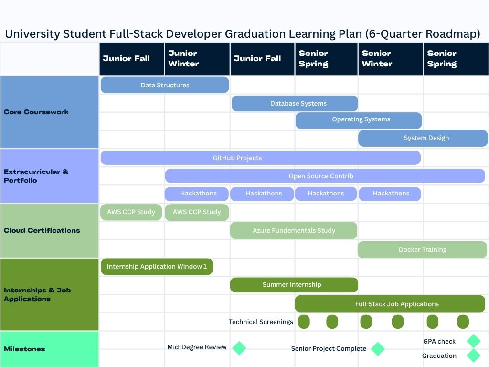

# Best Practices for Preparing for a Full Stack Developer Career Before Graduation

*© Christina @ wocintechchat.com via Unsplash*

## Table of Contents
- [Purpose](#purpose)
- [Building Core Engineering and Infrastructure Habits](#building-core-engineering-and-infrastructure-habits)
  - [Applying Architectural Thinking in Core Courses](#applying-architectural-thinking-in-core-courses)
  - [Pairing Backend Data with Cloud Workflows](#pairing-backend-data-with-cloud-workflows)
- [Gaining Practical Experience Outside the Classroom](#gaining-practical-experience-outside-the-classroom)
  - [Building Meaningful Collaborative Code on GitHub](#building-meaningful-collaborative-code-on-github)
  - [Aligning Internships and Capstone Milestones](#aligning-internships-and-capstone-milestones)
- [Strengthening Communication and Interview Readiness](#strengthening-communication-and-interview-readiness)
- [References](#references)

## Purpose
Securing an entry-level Full Stack Developer role takes more than finishing standard classes; you need hands-on habits that match how engineering teams ship software. Following a focused graduation plan helps you build practical system design, deployment, and teamwork skills before applying for full-time positions. Using these practices early gives you concrete projects and clear examples to stand out during competitive hiring cycles.

## Building Core Engineering and Infrastructure Habits

### Applying Architectural Thinking in Core Courses

Writing local code without structured design habits leaves you vulnerable to technical debt and messy repositories. Team-based software projects rely on clear system structure and deliberate planning so code stays maintainable as features grow.

Use required courses like CSS 360 Software Engineering and CSS 370 Analysis and Design to practice disciplined engineering habits rather than treating them as simple checkboxes. Break features into clear modules, sketch system models before writing code, and document design trade-offs during team projects so your work stays easy to follow and update.

### Mastering Backend Data and Cloud Workflows

A frontend interface alone cannot support a production app without dependable data storage and repeatable deployment pipelines [2]. Full stack development requires connecting client code to well-structured databases and predictable server environments.

Build end-to-end projects around CSS 475 Database Systems and CSS 436 Cloud Computing by designing clean schemas, writing efficient queries, and deploying services to the cloud. Pair those classes with hands-on practice in Docker containers and automated build-and-test workflows so releases stay consistent.

## Gaining Practical Experience Outside the Classroom

### Building Meaningful Collaborative Code on GitHub

Solo class assignments rarely show how teams handle pull requests, merge conflicts, and code reviews. Contributing to shared repositories and hackathons builds real version control habits and gives hiring managers concrete proof of how you work with others [3].

Join UWB ACM hackathons and contribute to active open-source projects with clear issues and code reviews. Focus on small, well-tested pull requests and thoughtful review comments so your commit history reflects real problem-solving and teamwork rather than empty activity just to fill a chart.

### Aligning Internships and Capstone Milestones

Missing recruiting deadlines is an easy way to lose out on strong software internships and early-career roles [1]. Planning your quarters around hiring calendars keeps your portfolio and availability ready when applications open.

Map your application prep ahead of peak recruiting windows, and treat your capstone as a flagship project you can explain end to end. Instead of cramming everything into one timeline, focus on the timing trade-off shown in Figure 1 between capstone scope and recruiting cycles.

*Figure 1: Trade-offs Between Capstone Feature Scope and Internship Recruiting Windows.*

## Developing Professional Communication and Interview Readiness

Strong coding skills will not carry you through interviews if you cannot explain how you debugged an issue or worked with a teammate. Recruiters and engineers evaluate clear communication, ownership, and team fit alongside technical ability.

Prepare concise STAR (Situation, Task, Action, Result) stories from group projects, part-time work, and hackathons, and practice explaining technical choices in plain language. Conduct informational interviews with working software professionals and give clear feedback during peer evaluations to sharpen how you communicate under pressure [4].

---

## References

[1] U.S. Bureau of Labor Statistics, "Occupational Outlook Handbook: Software Developers," *U.S. Bureau of Labor Statistics*, Sep. 6, 2023. [Online]. Available: https://www.bls.gov/ooh/computer-and-information-technology/software-developers.htm. [Accessed Oct. 22, 2026].

[2] D. Cassel, "What Do Full-Stack Developers Actually Do Today?", *The New Stack*, Feb. 14, 2024. [Online]. Available: https://thenewstack.io/what-do-full-stack-developers-today/. [Accessed Oct. 22, 2026].

[3] GitHub Docs, "Contributing to a project," *GitHub Docs*, 2026. [Online]. Available: https://docs.github.com/en/get-started/exploring-projects-on-github/contributing-to-a-project. [Accessed Oct. 22, 2026].

[4] [Interviewee Name], Informational Interview with [Role/Company], [Month Day, Year]. *(Add full IEEE interview details here so your informational interview citation is complete.)*

[word count: 604]
