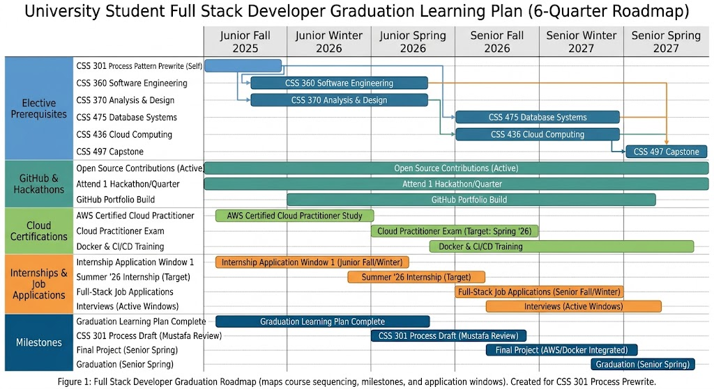

# Best Practices for Preparing for a Full Stack Developer Career Before Graduation

Securing an entry-level Full Stack Developer position requires bridging the gap between standard university coursework and production-level industry expectations. Following a structured graduation learning plan ensures you acquire the necessary system design, cloud deployment, and professional collaboration competencies before entering the job market.

## Selecting Upper-Division Software and Database Electives

### Building Architectural Foundations in Core Engineering Courses

Writing local code without understanding structured software lifecycles or design principles leaves you vulnerable to technical debt and disorganized repository architectures. Enterprise development teams rely on formalized design patterns and rigorous engineering processes to maintain scalable codebases across distributed teams.

Enroll in CSS 360 Software Engineering and CSS 370 Analysis and Design early in your junior year to master object-oriented system modeling, UML diagrams, and software lifecycle management. Apply these design principles directly to team projects to simulate real-world software engineering workflows.

### Mastering Backend Data and Cloud Infrastructure

Static frontend interfaces fail to meet production standards unless supported by robust backend data structures and modern cloud deployment pipelines. Modern full-stack development requires balancing application logic with containerized server environments and cloud database management.

Schedule CSS 475 Database Systems and CSS 436 Cloud Computing during your senior sequence to master relational database optimization and cloud-native infrastructure provisioning. Pair these courses with independent study on Docker containerization and continuous integration workflows.

## Expanding Practical Experience Outside the Classroom

### Contributing to Collaborative GitHub Projects and Hackathons

Class assignments alone do not simulate the code review, branching complexities, and merge conflict resolution characteristic of professional engineering teams. Engaging with open-source repositories and collegiate hackathons builds your collaborative version control proficiency and demonstrates real-world output to hiring managers.

Participate in UWB ACM hackathons and fork active open-source projects on GitHub to practice pull request workflows, issue tracking, and code reviews. Maintain regular contribution graphs to signal technical dedication to prospective employers.

### Completing Industry Internships and Capstone Milestones

Failing to align academic quarter schedules with corporate recruitment timelines results in missed hiring windows for competitive software engineering internships. Strategic planning of your final quarters synchronizes graduation milestones with optimal corporate application cycles.

Coordinate your course schedule with recruitment windows by reviewing Figure 1 below, mapping your junior and senior internship application phases directly alongside your capstone enrollment.

*Figure 1: Full Stack Developer Graduation Roadmap (maps course sequencing, milestones, and application windows). Created for CSS 301 Process Prewrite.*

## Developing Professional Communication and Interview Readiness

Technical competency remains insufficient for hiring success if you cannot articulate your problem-solving process or demonstrate professional teamwork. Recruiters evaluate behavioral soft skills and structured communication alongside your technical coding capabilities during screening pipelines.

Practice the STAR (Situation, Task, Action, Result) method for behavioral interviews and build National Association of Colleges and Employers (NACE) career readiness competencies through mock technical presentations and informational interviews with industry professionals. Explain complex code adjustments clearly during peer evaluations to refine your technical communication skills.

---

## References

[1] U.S. Bureau of Labor Statistics, "Occupational Outlook Handbook: Software Developers," bls.gov, 06 Sep. 2023. [Online]. Available: https://www.bls.gov/ooh/computer-and-information-technology/software-developers.htm. [Accessed Oct. 22, 2026].

[2] D. Cassel, "What Do Full-Stack Developers Actually Do Today?", The New Stack, 14 Feb. 2024. [Online]. Available: https://thenewstack.io/what-do-full-stack-developers-actually-do-today/. [Accessed Oct. 22, 2026].

[3] GitHub Docs, "Contributing to a project," GitHub, Inc., 2026. [Online]. Available: https://docs.github.com/en/get-started/exploring-projects-on-github/contributing-to-a-project. [Accessed Oct. 22, 2026].

[4] National Association of Colleges and Employers (NACE), "Career Readiness Competencies," naceweb.org, 2026. [Online]. Available: https://www.naceweb.org/career-readiness/competencies/career-readiness-defined/. [Accessed Oct. 22, 2026].

[5] Kaan [Last Name Withheld], Full Stack Developer at Costco Wholesale, Personal interview, 2026.

[word count: 645]
